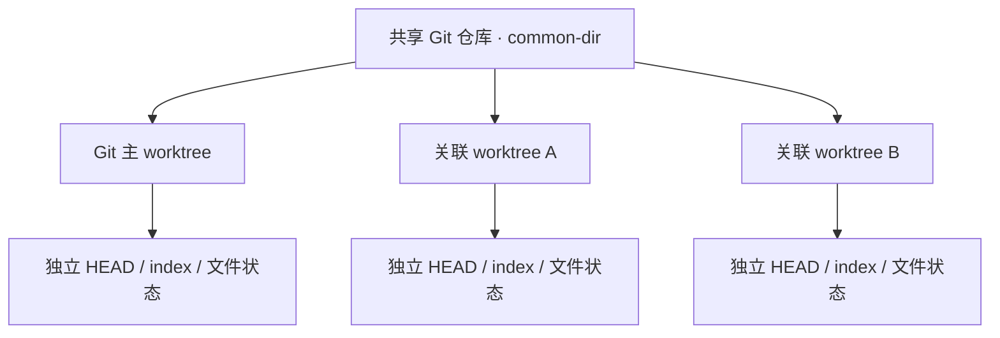

# 子工作区 Git 受控识别变更需求

## 文档状态与追溯入口

- 最近修订：2026-10-22。
- 第 1～10 节保留子仓库发现与选择的原始需求基线；其中“当前限制”描述提出需求时的情况，不代表现有代码仍全部缺失。
- 本次扩展：B-009 远程同步与完整提交图、B-010 同仓库 worktree 关系图与清理准备；阶段 A 已实现并验证，阶段 B 的实际移除保留后续；证据见验收报告第 8 节。
- 来源：2026-10-21 用户提出远程提交/其他分支不可见，以及 `/Volumes/T7/project/project_maikoo` 多 worktree 缺少归组视图；2026-10-22 要求补充到现有需求文档。
- 新增范围及与原基线的关系以第 11～16 节为准；本文定义需求与验收口径，开发计划和其他文档引用本文，不另建第二套规则。

导航：[原始目标](#3-目标) · [原始验收](#7-验收标准) · [核查与范围](#11-2026-10-22-扩展需求基线) · [远程与提交图](#12-b-009远程同步与完整提交图) · [Worktree](#13-b-010同仓库-worktree-关系图与清理准备) · [契约与实现边界](#14-数据契约与接口演进) · [验收矩阵](#15-验收与追溯矩阵) · [更新记录](#16-更新记录)

关联文档：[Backlog](backlog.md) · [专项开发计划](subworkspace-git-development-plan.md) · [详细设计](detailed-design.md#21-远程提交图与-worktree-设计扩展) · [总任务计划](task-plan.md#13-远程提交图与-worktree-后续任务) · [验收记录](acceptance-report.md#8-远程提交图与-worktree-扩展验收)。

## 1. 背景

当前 `Code Workspace` 支持打开一个本地目录，并基于该目录识别 Git 仓库、展示文件树、Git 修改、历史、分支和 Diff。

实际使用中，Codex 工作目录经常不是单一 Git 仓库，而是一个聚合目录：

```text
im-workspace/
  im-rpc -> /Volumes/.../im-rpc
  imv2-server -> /Volumes/.../imv2-server
  imv2-webv2 -> /Volumes/.../imv2-webv2
  imv3-uniapp -> /Volumes/.../imv3-uniapp
```

这些目录多数是符号链接，真实 Git 仓库可能位于一级目录，也可能位于二级目录，例如 `clients/web -> /path/web` 或 `services/im-rpc -> /path/im-rpc`。当前系统只检测工作区根目录是否为 Git 仓库，因此打开聚合目录后看不到子项目的受控状态、修改列表、分支、历史和 Diff。

## 2. 现状审核

### 2.1 已具备能力

- 文件树已支持打开 symlink 指向的目录和文件。
- Watcher 已配置 `followSymlinks: false`，避免打开聚合目录时递归监听大量子仓库导致 `EMFILE`。
- Git 能力已覆盖单仓库：状态、分支、切换、历史、提交图、Diff、图片 Diff。

### 2.2 当前限制

- `WorkspaceService.open()` 只在工作区根目录执行 `git rev-parse --show-toplevel`。
- `WorkspaceInfo.git` 只能表达一个 Git 仓库。
- `GitService` 只有一个 `gitRunner`，所有 Git API 默认指向根仓库。
- `/api/files/tree` 的 Git 状态标识只在根目录是 Git 仓库时生效。
- 前端 Git 面板没有“当前正在查看哪个项目 Git”的明确标识。
- 打开聚合目录时，用户无法知道 Git 面板不可用是因为没有仓库，还是因为仓库位于未扫描到的子目录深度内。

## 3. 目标

支持“聚合工作区 + 配置深度内子 Git 仓库”的使用模式，让用户能在同一个 Code Workspace 中：

- 看到配置深度内的子目录是否是 Git 受控项目。
- 选择当前 Git 项目。
- 在明显位置看到当前 Git 面板对应的项目名称、路径和分支。
- 查看所选子项目的 Git 修改、历史、分支、Diff 和提交图。
- 在文件树中看到子项目自身的 Git 修改标识。

## 4. 非目标

本次变更不做：

- 多仓库同时聚合提交。
- 跨仓库统一 Diff。
- 跨仓库批量 stage、commit、push、pull。
- 自动递归扫描任意深度 Git 仓库。
- 对 `node_modules`、`target`、`dist` 等生成目录进行 Git 状态扫描。
- 终端、Codex 会话或 AI 功能。

## 5. 需求完善

### 5.1 子仓库发现深度配置

系统应支持通过配置控制 Git 子仓库发现深度，而不是写死只扫描一级目录。

建议新增配置项：

| 配置项 | 默认值 | 说明 |
|---|---:|---|
| `GIT_DISCOVERY_DEPTH` | `1` | 从工作区根目录向下发现 Git 仓库的最大目录深度。`0` 表示只检测根目录，`1` 表示根目录和一级目录，`2` 表示根目录、一级和二级目录。 |
| `GIT_DISCOVERY_MAX_DIRS` | `200` | 单次发现最多检查的目录数量，避免大型目录树卡住打开流程。 |
| `GIT_DISCOVERY_TIMEOUT_MS` | `5000` | Git 仓库发现总耗时上限，超时后返回已发现结果并提示发现不完整。 |

默认建议为 `1`，以兼容当前 IM 聚合工作区；用户可按需配置为 `2`。

### 5.2 子仓库发现

系统打开工作区后，应发现以下 Git 项目：

- 工作区根目录本身是 Git 仓库时，加入 Git 项目列表。
- 工作区根目录下配置深度内的目录是 Git 仓库时，加入 Git 项目列表。
- 工作区根目录下配置深度内的 symlink 指向目录且目标是 Git 仓库时，加入 Git 项目列表。

发现规则：

- 深度从工作区根目录开始计算，根目录为 `0`。
- 当 `GIT_DISCOVERY_DEPTH=1` 时，扫描根目录和一级目录。
- 当 `GIT_DISCOVERY_DEPTH=2` 时，扫描根目录、一级目录和二级目录。
- 如果某个目录已识别为 Git 仓库，不继续向它的子目录递归发现，避免把 Git 仓库内部的依赖、子模块或构建目录误扫为普通工作区结构。
- 发现过程应跳过 `.git`、`node_modules`、`target`、`dist`、`build`、`coverage`、`.gradle`、`.idea`、`.cursor`。
- 如触达 `GIT_DISCOVERY_MAX_DIRS` 或 `GIT_DISCOVERY_TIMEOUT_MS`，应返回已发现仓库，并在工作区信息中标记发现结果不完整。

发现结果应包含：

- `id`：稳定标识，可由逻辑路径或真实仓库路径生成。
- `name`：项目名，优先使用工作区内显示名，例如 `im-rpc`。
- `workspacePath`：工作区相对路径，例如 `im-rpc`。
- `repositoryRoot`：真实 Git 根目录。
- `branch`：当前分支。
- `head`：当前提交。
- `detached`：是否 detached HEAD。
- `current`：是否为当前 Git 面板选中的项目。
- `discoveryDepth`：发现该仓库时所在深度。

### 5.3 当前 Git 项目选择

打开工作区后默认选择规则：

1. 如果根目录本身是 Git 仓库，默认选择根仓库。
2. 如果根目录不是 Git 仓库，但配置深度内发现子仓库，默认选择排序后的第一个子仓库。
3. 如果没有发现任何 Git 仓库，Git 面板显示“未发现 Git 项目”。

用户可以在顶部栏或 Git 面板顶部切换当前 Git 项目。

### 5.4 当前受控项目标识

界面必须在明显位置展示当前 Git 项目，避免用户误以为正在查看整个聚合目录。

建议展示位置：

- 顶部栏分支选择器左侧或合并为一个 Git 项目选择器。
- Git 修改面板顶部。
- Git 历史面板顶部。

展示内容：

```text
Git 项目：im-rpc
路径：im-rpc
分支：feature/demo
```

空间不足时可展示：

```text
im-rpc · feature/demo
```

悬浮提示展示完整真实路径。

### 5.5 Git API 作用域

所有 Git API 应支持指定项目：

```text
GET  /api/git/repositories
GET  /api/git/repository?repositoryId=
GET  /api/git/status?repositoryId=
GET  /api/git/branches?repositoryId=
POST /api/git/switch
GET  /api/git/history?repositoryId=
GET  /api/git/graph?repositoryId=
GET  /api/git/commits/:hash?repositoryId=
GET  /api/git/diff?repositoryId=&scope=&path=
GET  /api/git/diff/commits/:hash?repositoryId=&path=
GET  /api/git/image?repositoryId=&source=&path=&hash=
```

兼容策略：

- 如果只有一个 Git 项目，可允许省略 `repositoryId`。
- 如果有多个 Git 项目且未传 `repositoryId`，后端使用当前选中项目。
- 后端不能仅依赖前端传入的 `repositoryRoot`，必须通过已发现的 `repositoryId` 映射。

### 5.6 路径语义

Git API 中的 `path` 应为仓库相对路径，而不是工作区根相对路径。

示例：

```text
工作区路径：im-rpc/im-common/src/main/java/A.java
Git 项目：im-rpc
Git path：im-common/src/main/java/A.java
```

文件树返回 Git 状态时，后端需要把工作区路径映射到所属 Git 项目，再转换为该仓库内路径。

### 5.7 文件树 Git 状态

文件树应支持多仓库状态标识：

- 子仓库根目录如果有修改，显示 `descendantChanged = true`。
- 展开子仓库后，子目录和文件显示该仓库内的 Git 状态。
- 不同仓库的状态不能互相污染。
- 未选择 Git 项目时，文件树仍可显示所有发现仓库的状态摘要。

### 5.8 Git 面板行为

Git 修改、历史、提交图、分支切换都作用于当前选中的 Git 项目。

切换 Git 项目时：

- Git 修改面板刷新为目标项目状态。
- Git 历史面板刷新为目标项目历史。
- 已打开的 Diff 标签应标记为过期，或在标题中保留所属项目名。
- 分支选择器切换为目标项目的分支列表。

### 5.9 Diff 标签标题

Diff 标签标题必须包含项目名，避免多仓库中同名文件混淆。

示例：

```text
im-rpc · working: im-common/pom.xml
imv2-server · 3a91c2b: src/main/resources/app.yml
```

### 5.10 文件监听与刷新

保持 `followSymlinks: false`，避免聚合目录打开时监听真实子仓库全量内容。

刷新策略建议：

- 当前选中 Git 项目的状态由用户刷新、Git 面板打开、文件树展开、或定时轻量刷新触发。
- 对 symlink 子仓库不做全量 watcher 监听。
- 后续如需实时感知子仓库变化，可只监听已选 Git 项目的根目录，并继续忽略 `.git/objects`、`node_modules`、`target`、`dist`。

## 6. 推荐方案

### 6.1 后端模型

新增 `GitRepositoryInfo`：

```ts
interface GitRepositoryInfo {
  id: string;
  name: string;
  workspacePath: string;
  repositoryRoot: string;
  branch: string | null;
  head: string | null;
  detached: boolean;
  current: boolean;
  discoveryDepth: number;
}
```

扩展 `WorkspaceInfo`：

```ts
interface WorkspaceInfo {
  id: string;
  name: string;
  rootPath: string;
  openedAt: string;
  git: null | GitRepositoryInfo;
  repositories: GitRepositoryInfo[];
}
```

保留 `git` 字段作为当前选中 Git 项目，降低前端改动范围。

### 6.2 后端服务

建议新增或调整：

- `WorkspaceService.discoverGitRepositories(depth, maxDirs, timeoutMs)`：按配置发现根仓库和子仓库。
- `WorkspaceService.selectGitRepository(repositoryId)`：切换当前 Git 项目。
- `GitService.context(repositoryId?)`：按项目获取 `GitRunner`。
- `GitService.toRepositoryPath(workspacePath, repositoryId)`：工作区路径转仓库路径。

### 6.3 前端交互

顶部栏新增 Git 项目选择器：

```text
[Code Workspace] [im-workspace] [Git: im-rpc · main ▼] [刷新] [切换工作区]
```

Git 面板顶部增加当前项目横条：

```text
Git 项目
im-rpc · main
im-rpc
```

如果没有 Git 项目：

```text
未发现 Git 项目
当前工作区根目录和配置发现深度内未发现 Git 仓库。
```

## 7. 验收标准

### 7.1 聚合工作区

给定工作区：

```text
workspace/
  repo-a -> /tmp/repo-a
  repo-b -> /tmp/repo-b
  notes.txt
```

当 `repo-a` 和 `repo-b` 都是 Git 仓库，且 `GIT_DISCOVERY_DEPTH >= 1` 时：

- 打开 `workspace` 后，Git 项目列表包含 `repo-a` 和 `repo-b`。
- 默认选中一个子仓库。
- 顶部栏能看到当前选中的 Git 项目名。
- 切换到 `repo-b` 后，Git 修改、历史、分支和 Diff 都来自 `repo-b`。

### 7.2 二级仓库发现

给定工作区：

```text
workspace/
  services/
    repo-a -> /tmp/repo-a
  clients/
    repo-b -> /tmp/repo-b
```

当 `GIT_DISCOVERY_DEPTH=1` 时：

- Git 项目列表不包含 `services/repo-a` 和 `clients/repo-b`。
- Git 面板提示可提高发现深度或打开具体子目录。

当 `GIT_DISCOVERY_DEPTH=2` 时：

- Git 项目列表包含 `services/repo-a` 和 `clients/repo-b`。
- 顶部栏展示项目名时能区分同名仓库，必要时显示 `services/repo-a`。

### 7.3 文件树状态

- `repo-a` 内有未提交修改时，根文件树中的 `repo-a` 有明显修改标识。
- 展开 `repo-a` 后，具体修改文件有 Git 状态标识。
- `repo-a` 的修改不会显示到 `repo-b`。

### 7.4 Diff 标识

- 从 `repo-a` 打开的 Diff 标签标题包含 `repo-a`。
- 切换到 `repo-b` 后，原 `repo-a` Diff 不会被误认为是当前项目 Diff。

### 7.5 性能

以 IM 聚合工作区为基准：

- 打开工作区不触发 `EMFILE`。
- 打开后 2 秒内显示根文件树。
- 获取 Git 项目列表不递归扫描 `node_modules`、`target`、`dist`。
- `GIT_DISCOVERY_DEPTH=2` 时仍遵守 `GIT_DISCOVERY_MAX_DIRS` 和 `GIT_DISCOVERY_TIMEOUT_MS`。
- 切换 Git 项目后，Git 状态查询遵循现有 Git 超时配置。

### 7.6 安全

- 文件 API 仍禁止直接访问 `.git`。
- `repositoryId` 必须来自后端发现结果，前端不能传任意路径执行 Git。
- Git 命令继续使用 `spawn` 参数数组，不经过 shell。
- 删除 symlink 目录只删除链接本身，不删除链接目标真实目录。

## 8. 风险与待确认

| 风险 | 影响 | 建议 |
|---|---|---|
| 子仓库数量过多 | Git 状态查询变慢 | 默认只查当前项目，文件树只做可见节点状态；发现阶段受 `GIT_DISCOVERY_MAX_DIRS` 保护 |
| 发现深度过大 | 打开工作区变慢 | 默认深度为 1，建议 UI 或文档提示生产使用不超过 2 |
| symlink 目标在工作区外 | 文件访问范围扩大 | 当前产品已按用户需求允许工作区内 symlink；需在 UI 显示真实路径提示 |
| 多仓库同名文件 | Diff 标签混淆 | 标题必须带项目名 |
| 子仓库 watcher 全量监听 | 再次触发 `EMFILE` | 初期不跟随 symlink 监听；只按需刷新 |
| Git API 兼容性 | 前端改动面增大 | 保留 `WorkspaceInfo.git` 表示当前项目，新增 `repositories` |

## 9. 实施拆分

### P1：发现与选择

- 扩展共享类型。
- 打开工作区时按 `GIT_DISCOVERY_DEPTH` 发现根仓库和子仓库。
- 增加发现深度、最大目录数和发现超时配置。
- 新增 Git 项目列表 API。
- 前端展示当前 Git 项目选择器。

### P2：Git API 多仓库化

- `GitService` 支持 `repositoryId`。
- 修改 Git 状态、分支、历史、图、Diff、图片 Diff API。
- Diff 标签加入项目名前缀。

### P3：文件树 Git 状态

- 将文件树路径映射到所属仓库。
- 根目录显示子仓库受控状态摘要。
- 展开子仓库后显示具体文件 Git 状态。

### P4：验证与文档

- 增加 symlink 子仓库集成测试。
- 增加多仓库 Git API 测试。
- 更新 README、详细设计和验收报告。

## 10. 审核结论

该需求成立，属于当前 symlink 工作区支持后的必要补齐项。

推荐按“当前选中 Git 项目”的方式实现，而不是一次性把多个仓库的 Git 状态混成一个列表。这样能保持 Git 语义清晰，也能避免大型聚合工作区下性能不可控。

本变更应进入 V1.2 或 V1.1 后续增强，不建议和基础文件树 symlink 支持混在同一个提交中实现。

## 11. 2026-10-22 扩展需求基线

### 11.1 用户问题与核查结论

| 追溯编号 | 用户需求 | 已确认的代码现状 | 本次补齐目标 |
|---|---|---|---|
| B-009 | 远程有新提交后，能查看其内容和其他分支的完整 Commit Graph | 图查询已有 `git log --all`，但没有 fetch；线性历史只查 HEAD；图默认每页 100 条，本地/远程分支装饰通过名称猜测 | 远程同步、明确历史范围、完整分页、准确 refs、提交详情与多文件 Diff |
| B-010 | 同一受控仓库的多个 worktree 能用图展示目录、分支、未提交内容和主工作区，便于后续清理 | 以 `--show-toplevel` 路径生成仓库 ID，多个 worktree 被当成多个独立仓库；没有 common-dir、主 worktree 和 worktree 注册清单模型 | 共享仓库归组、独立 worktree 状态、关系图、清理前信息与后续受控移除 |

已核查的代码入口：`src/server/services/git-service.ts` 的 `graph/history`、`src/server/services/workspace-service.ts` 的 `probeRepository`、`src/shared/contracts.ts` 的 `GitRepositoryInfo`、`src/web/App.tsx` 的 `HistoryPanel/CommitGraph/openDiff`、`src/server/services/file-service.ts` 的 `remove`。入口名称用于定位，实施时以实际代码为准。

2026-10-21 只读核查快照：

- MaiKoo 远程有 8 个分支，其分支头均与本机远程跟踪记录一致；该次核查没有证明当时存在未 fetch 的远程提交，不能把用户现象一概归因为同步落后。
- 本机 `git rev-list --all --count` 为 136，HEAD 可达提交为 111；现有图接口返回 100 + 36 条，两页合并覆盖当时全部 12 个本地分支和 8 个远程分支的分支头。
- `origin/feat/paysomi-card`、`origin/feat/paysomi-ca9-postmessage` 的分支头在第二页。`--all` 统计也可能包含 stash 等内部 refs，136 不是未来默认“全部分支”视图的固定验收数量。
- 如加载完全部页面仍缺失提交，应继续核查运行版本、浏览器缓存和渲染；这部分现象尚未通过浏览器复现。

### 11.2 交付范围与阶段

| 阶段 | 范围 | 状态 |
|---|---|---|
| 本轮文档交付 | 补齐需求、稳定编号、验收条件、实施映射和历史证据 | 文档修订；不表示功能已实现 |
| 功能阶段 A | GG-01～GG-08、WT-01～WT-07、WT-09～WT-11：同步远程、完整历史、worktree 图、状态和清理预览 | 已实现，见验收报告第 8～10 节 |
| 后续阶段 B | WT-08：用户明确发起的 worktree 移除执行 | 后续实现，独立验收；阶段 A 不提供可执行删除按钮 |

第 4 节的跨仓库批量提交、跨仓库 Diff、任意深度扫描、终端和 AI 非目标继续有效。受控 fetch 是新增范围，不包含 pull、merge、rebase、push、stage、commit、自动 stash、分支删除、Tag 删除或自动清理 worktree。默认不周期性自动 fetch。

## 12. B-009：远程同步与完整提交图

### 12.1 功能需求

| 编号 | 必须满足的行为 |
|---|---|
| GG-01 | 在当前共享仓库提供“同步远程”入口，获取已配置远程的分支引用及 Tag 对象，之后可查看新提交及其内容。同步是 fetch，不切换分支、不修改工作文件、不合并提交。多个 worktree 共用同一个同步任务。 |
| GG-02 | 默认提交图展示“全部分支”；图与线性历史均可选择全部分支、当前 worktree 的当前分支、指定本地或远程分支，并始终标出实际范围。查看其他分支不要求 checkout。 |
| GG-03 | 支持持续分页，显示已加载数量、是否还有历史及加载错误；不能把首批 100 条呈现为全部历史。取得可靠总量时显示总量，否则明确“总量未知/尚有更多”。分页期间 refs 变化应使旧图版本失效并从首批重载。 |
| GG-04 | 按完整 ref 命名空间区分本地分支、远程跟踪分支和 Tag；不能通过 `/` 或 `origin` 前缀猜测。提交节点可同时显示多个 refs 和多个 worktree 的 HEAD 标记，单个提交只绘制一次。 |
| GG-05 | 任意已加载提交均可打开详情、文件清单和逐文件 Diff；“全部 Diff”必须可访问全部受影响文件，不能只显示第一项。根提交和合并提交保持明确的比较基线，默认合并提交与第一父提交比较。 |
| GG-06 | 显示同步状态、各远程最后成功时间、失败原因及重试入口；普通刷新必须标明只重新读取本地数据。外部 fetch、refs/Tag/HEAD 变化和显式同步完成后，相关图、分支、worktree 同步指标和旧 Diff 一起失效。 |
| GG-07 | Git 历史支持全屏查看和按钮/Esc 退出，切换时保留范围、已加载分页及所选提交；从全屏打开 Diff 时返回编辑区。 |
| GG-08 | 醒目标识当前 worktree 的本地 HEAD，提供定位入口，并显示相对 upstream 的领先/落后数量。按祖先可达关系区分本地独有、与远程共有、远程独有和其他本地引用；不能仅依据提交是否直接带分支标签判断。远程以已获取的跟踪引用为准，无引用或查询失败时显示未知；浅仓库显示边界。 |

### 12.2 “全部”的定义及远程同步规则

- 全部分支范围是当前共享仓库已取得的本地分支、远程跟踪分支、Tag，以及已登记 worktree HEAD 可达提交的并集；包括 detached worktree HEAD 可达提交，不等同于远端尚未下载的对象或 Git 中所有悬空对象。
- stash、reflog、内部管理 refs 不冒充普通分支；默认分支图不包含 stash 历史。浅仓库或对象不完整时显示边界，不能声明完整历史；不自动改变浅克隆策略。
- 首次打开读取本地快照并显示“同步远程”入口；离线仍可查看本地历史。同步失败不把旧快照标为最新，也不清空已有图和未保存编辑。
- 使用后端已有远程配置，不接受浏览器传入远程 URL、shell 命令或任意 Git 参数。远程名须来自后端清单；不静默修改持久化 fetch refspec。
- 若持久化 refspec 仅获取部分分支，必须显示范围受限；“同步全部分支”使用服务端构造的受控 refspec，不把有限同步宣称为远程全量。
- 同步处理远程已删除的跟踪分支；不删除本地分支或本地 Tag。多远程部分失败时逐个报告结果，不能统一显示成功。
- 按共享仓库串行或合并重复 fetch；有明确超时，认证不足时报告失败，不在服务进程中无限等待交互输入，不输出含凭证的 URL 或原始认证信息。

### 12.3 图和详情交互

- 进入 Git 历史默认选择“全部分支”提交图；切换列表/图时保持相同范围与所选提交，且无需切换 worktree 的磁盘分支。
- 图显示分叉、合并和分页边界；父节点未加载时显示延续标识，不能把边界误画成根提交。
- 同步或外部 refs 变化后重建分页快照，旧页不得与新页按 offset 混拼。仍存在的所选提交可保留；已不在当前范围内时提示并允许返回。
- 从 worktree 图点击分支/HEAD，可定位相同仓库提交图中的节点；从提交图上的 worktree 标记可打开对应 worktree 摘要。

## 13. B-010：同仓库 worktree 关系图与清理准备

### 13.1 功能需求

| 编号 | 必须满足的行为 |
|---|---|
| WT-01 | 使用规范化的 Git common-dir 标识共享仓库，通过 `git worktree list --porcelain -z` 获取登记清单。独立 clone 即使远程 URL 相同也分为不同组；同一 worktree 的符号链接别名不重复计数。 |
| WT-02 | 区分 Git 主 worktree、关联 worktree、当前 UI 选中 worktree 和承载默认分支的 worktree；这些标识不能合并。主 worktree 由 Git 元数据确认，不由目录名、排序或是否检出 `main` 推断。 |
| WT-03 | 每个 worktree 独立展示路径、分支或 detached HEAD、短提交号、已暂存/未暂存/未跟踪/冲突数量及读取时间。状态失败显示未知和原因，不得当作 0 或干净。 |
| WT-04 | 分开显示文件是否干净、相对 upstream 的 ahead/behind、HEAD 是否被远程跟踪分支包含，以及相对默认分支的祖先关系。没有 upstream、未同步或默认分支未知时明确标为未知/不适用，不能猜为 0。 |
| WT-05 | 提供“共享仓库 → 各 worktree”关系图，主 worktree 和当前选中项有文字标记。节点显示分支与文件状态摘要，点击后可查看修改、提交与完整路径；可按有修改/干净查看，颜色不能是唯一状态标识。 |
| WT-06 | 发现一个 worktree 后能展示其 Git 登记的同组 worktree；位于当前打开目录外、路径缺失、locked、prunable 的项明确标记。目录扫描限制不等于 worktree 登记范围；登记清单读取和状态查询需有数量/超时边界，并报告未读取项。 |
| WT-07 | 提供只读清理预览：列出目标路径、分支、主/关联身份、文件状态、未保存编辑、未推送提交、锁定/失效状态和不可操作原因。阶段 A 仅帮助判断候选，不能将“干净”直接等同为“可删除”。 |
| WT-08 | 后续支持单个 worktree 受控移除：用户明确选择目标并确认后，重新校验状态，使用 Git worktree 移除命令注销登记；保留本地分支，不提供强制删除、批量删除或自动 prune。独立于阶段 A 交付。 |
| WT-09 | 顶部全局统计已登记 worktree 总数、有修改、干净及未知数量，按 worktree 去重，不能用修改文件数替代；筛选不改变全局统计。主工作区有明显文字标识，并可展开查看全部主项的目录与分支；清单不完整时说明统计范围。 |
| WT-10 | 默认以紧凑列表显示目录、共享仓库、分支、主/当前身份、文件状态及未发布提交；跨仓库按“修改 → 干净 → 未知”排序，未知不得当作干净。点击行才显示可关闭详情，默认不预留详情栏；同步、完整路径、独立修改、提交定位与只读清理预览放在详情中。 |
| WT-11 | Worktree 按 Git 地址分类，显示“配置的远程地址 → 本地 base（common-dir）→ Worktree”。优先选 origin 的首个 fetch URL；无 origin 时使用按名称排序的首个有 fetch URL 的远程。组标题直接展示脱敏地址、base 数、worktree 数及修改/干净/未知计数，其他 fetch/push 地址可展开且详情保留远程名。相同展示地址的独立 clone 仅归入同一界面分类，base ID、主项、同步与操作作用域保持分离；不同 URL 表达形式不猜测为同一远程。无远程或读取失败按各本地 base 单列并准确提示。分类及 base 按修改优先排列，base 内按修改/干净/未知排序；本条的归属分组优先于 WT-10 原跨仓库平铺排序。筛选保持全局统计、按需详情和既有操作作用域。 |

### 13.2 仓库与 worktree 两层语义



- 共享仓库负责 refs、对象、fetch、公共历史和同组 worktree 清单；worktree 负责 cwd、HEAD、index、文件内容、未提交修改和分支切换。
- 归组不能让多个 worktree 共用一个状态缓存、Git 执行 cwd 或文件路径映射。文件树保留每个目录入口，仓库总览按组展示。
- `changedFileCount` 是各 worktree 的变更路径去重数量；同一文件同时 staged/unstaged 只计一个变更文件，分类数量可交叉。跨 worktree 汇总按 `(worktreeId, path)` 计数，不能按仓库相对路径合并不同工作目录的修改。
- 主 worktree 无法确认或仓库为 bare 时，主项显示未知/不适用；不随意把列表第一项指定为主项。默认分支也不能硬编码为 `main`。
- 查询失败、未完成、超时和超限都应显示状态未知或部分结果；文件树/编辑功能继续可用。

### 13.3 已核查的 MaiKoo 示例

以下为 2026-10-21 的证据快照，仅用于解释需求；实施及清理前必须重新读取，不能当成当前操作依据。共同 Git 目录为 `/Volumes/T7/project/project_maikoo/maikoo-pay/.git`。

| 目录（均位于 `project_maikoo/`） | 分支 | Git 身份 | 文件状态 | HEAD 中未被任意远程跟踪分支包含的提交数 |
|---|---|---|---|---:|
| `maikoo-pay` | `main` | 主 worktree | 1 个未暂存修改 | 0 |
| `maikoo-pay-ab-site-compose-analysis` | `feat/ab-site-compose-analysis` | 关联 worktree | 干净 | 0 |
| `maikoo-pay-cdn-enable-live` | `fix/cdn-enable-live` | 关联 worktree | 干净 | 0 |
| `maikoo-pay-finance-ledger-foundation` | `feat/finance-ledger-foundation` | 关联 worktree | 干净 | 18 |
| `maikoo-pay-main-20261021` | `codex/main-workspace-20261021` | 关联 worktree | 5 个未暂存、4 个未跟踪 | 0 |
| `maikoo-pay-redirect-iframe` | `main` | 关联 worktree | 干净 | 0 |
| `maikoo-pay-resource-scope-cdn` | `fix/resource-scope-cdn` | 关联 worktree | 11 个未暂存、6 个未跟踪 | 15 |

该次共有 1 个共享仓库、7 个 worktree、3 个有文件修改的 worktree；现有发现接口却把它们返回为 7 个独立仓库。finance 示例说明“文件干净”和“提交已经推送”是独立维度。未被远程包含的计数依据当时已核对的远程 refs；与 upstream ahead/behind 不是同一指标。

### 13.4 后续移除边界

- 阶段 A 可展示清理条件和原因，不假装执行成功；阶段 B 才增加执行入口。
- 禁止移除 Git 主 worktree。未保存编辑、已暂存/未暂存/未跟踪/冲突内容、locked、路径缺失、状态未知或超时的项不能直接移除；prunable 作为单独失效信息展示，不自动 prune。
- `.gitignore` 忽略内容不计入普通 `git status` 的干净判断；清理预览需单独检查是否存在，存在时本期后续移除流程保守阻止，不静默丢弃。
- 文件干净但存在未推送提交的关联 worktree，可在明确提示“提交仍在保留的本地分支中”后进入确认；移除 worktree 不连带删除分支。detached HEAD 未确认有 refs 保存其提交时阻止移除。
- 当前 UI 选中或被本服务其他 session 使用的 worktree 阻止移除，提示先切换/关闭。工作区外登记项只读展示；本期后续移除执行仅允许后端校验位于当前允许工作区范围内的目标。
- 删除必须按后端清单中的 ID 解析，不接受任意路径；预览携带状态版本，执行前重新查询。版本变化时要求刷新预览，Git 最终拒绝时保留现场并报告原因，不升级为强制删除。
- 文件树删除/重命名 worktree 根目录应阻止并引导至专用流程；普通 symlink 别名删除仍只移除链接本身，不等于删除其目标 worktree。
- 删除成功后刷新登记、图、选择项、文件树和状态缓存；失败不得显示成功。外部工具或其他进程正在使用目录无法仅靠 Git 判断，界面需要提示这一边界。

## 14. 数据契约与接口演进

本节保留契约要求；阶段 A 已按本节语义实现，实际字段/接口及资源边界见详细设计第 21.6 节。DELETE 移除接口仍属后续阶段 B。

### 14.1 模型和作用域

| 模型 | 必要信息与语义 |
|---|---|
| 共享仓库 | `repositoryGroupId`、规范化 `commonDir`、已配置远程、已知默认分支、各远程同步状态、refs/graph 版本、worktree 列表 |
| Worktree | `worktreeId`、所属组 ID、真实路径及工作区别名、分支/HEAD、主/关联身份、当前选中状态、范围内外、locked/prunable/缺失信息 |
| Worktree 状态 | 文件分类及唯一变更数、干净/未知、upstream ahead/behind、远程包含关系/计数、相对默认分支关系、读取时间和错误 |
| 提交图快照 | 当前范围、所选 ref、`graphRevision`、提交与父关系、完整 refs、worktree HEAD 标记、分页结束标记及可用时的总量 |
| 清理预览 | 目标 worktree ID、状态版本、保留的分支、未推送/忽略文件提示、可否继续及具体原因；执行能力标明所属阶段 |

- 保留现有 `repositoryId` 作为工作目录选择标识的兼容入口，新增 `repositoryGroupId + worktreeId`；原字段与新 ID 的映射由后端返回，不把旧工作目录 ID 静默改成组 ID。
- status、working/staged/all Diff、工作区图片、文件树和 switch 按 worktree 执行；远程同步及公共 refs 按组执行；graph/history 按组解析提交，并用选中 worktree 解析“当前分支”范围。
- 历史提交 Diff 和图片也应能从任意对应 worktree 上下文读取同组对象；图片 URL、普通 HTTP、WebSocket 仍需携带原有 session 作用域。
- 其他 session 不能仅凭另一 session 的 ID 获得未发现工作目录的操作权限；同组 fetch 允许合并执行，但事件和选择状态仍按 session 分发。

### 14.2 建议接口与兼容方式

| 接口落点 | 用途 | 阶段 |
|---|---|---|
| 扩展 `GET /api/git/repositories` | 返回工作目录兼容项及共享仓库分组映射 | A |
| 新增 `GET /api/git/worktrees?repositoryGroupId=` | 返回登记清单、主/关联关系和可见状态摘要 | A |
| 新增 `POST /api/git/fetch` | 接收后端已登记的组 ID 和可选远程名，返回各远程同步结果 | A |
| 扩展 `/api/git/graph`、`/api/git/history` | 接收组、worktree、范围与已知 ref；返回版本化分页结果 | A |
| 扩展 `/api/git/status`、`/api/git/switch`、工作区 Diff/图片接口 | 明确 worktree 作用域，兼容原 `repositoryId` | A |
| 新增 `POST /api/git/worktrees/:worktreeId/removal-preview` | 只读检查候选并返回状态版本及阻止原因 | A |
| 新增 `DELETE /api/git/worktrees/:worktreeId` | 绑定确认和预览版本的单个受控移除 | B |

字段命名可在开发时按现有响应封装调整，但上述语义、兼容关系、阶段和验收编号不能丢失。若 Git 2.30 基线不支持所选机器可读参数，需在隔离样例验证等价解析或明确更新最低版本；不能靠解析面向人的表格输出兼容路径。

### 14.3 刷新、错误与资源限制

- 公共 refs、packed-refs、各 worktree HEAD/index、登记增删变化需触发相关缓存失效；不能只监听当前打开目录内的 `.git`。
- 仅监听必要 Git 元数据，避免递归监听 objects 或所有 worktree 源码；保持现有生成目录忽略和文件监听上限。监听不可用时提供手动刷新及降级说明。
- 状态查询有并发限制、单项超时及部分结果；worktree 列表数量限制和状态“尚未读取”需显式返回。清理判断必须获得目标最新状态，不能使用降级为 0 的计数。
- refs 变化后重置分页，不混合不同 graphRevision 的页；worktree 状态版本与共享 refs 版本分离，避免把一个 worktree 的保存事件误当成其他 worktree 的文件修改。

## 15. 验收与追溯矩阵

阶段 A 的执行结果见验收报告第 8 节；阶段 B 用例仍未执行。使用本地 bare remote、至少两个 clone、多个 worktree 和可控提交构造隔离样例；不得通过修改/删除真实 MaiKoo worktree 做破坏性验收。历史快照只作为需求证据。

| 验收编号 | 需求编号 | 场景与通过标准 |
|---|---|---|
| AC-GG-01 | GG-01、GG-06 | clone B 推送新提交/新分支，clone A 初始没有这些对象；界面同步后显示新 refs、提交和 Diff，A 的分支、index、工作文件及编辑缓冲不变。 |
| AC-GG-02 | GG-02 | 在当前分支未包含的其他本地/远程分支创建独有提交；全部范围能查看，限定范围准确过滤，切换列表/图保持同一范围且不 checkout。 |
| AC-GG-03 | GG-03 | 构造超过 200 条且有分叉/合并的历史，加载至结束后与约定 refs/HEAD 的 CLI 可达集合一致，无遗漏/重复；分页途中更新 refs 后旧页失效并重新开始。 |
| AC-GG-04 | GG-04 | `feat/x`、`fix/x`、`codex/x` 正确标为本地；非 origin 远程、带 `/` 的 Tag 正确分类；多个 worktree 指向同一提交只绘一个节点并显示全部标记。 |
| AC-GG-05 | GG-05 | 打开其他分支的根提交、合并提交及多文件提交，详情、逐文件 Diff 和全部文件入口可达；大文件/二进制限制提示准确，不静默只展示第一文件。 |
| AC-GG-06 | GG-01、GG-06 | 认证失败、离线、单远程失败、超时及同组重复同步均有准确状态；普通刷新不宣称已同步；远程删除分支后仅清理跟踪引用，本地分支/Tag 保留。 |
| AC-WT-01 | WT-01、WT-02 | 一个主 worktree、多个关联项及符号链接别名归为一组；远程相同的独立 clone 另成一组；打开关联项仍识别主项，不因名称或当前分支判断主身份。 |
| AC-WT-02 | WT-03、WT-04 | 各 worktree 构造 staged/unstaged/untracked/conflict、无 upstream、未推送和 detached 状态；与逐目录 CLI 结果一致，失败为未知；同一路径在不同 worktree 的修改不串状态。 |
| AC-WT-03 | WT-05 | 实际浏览器验证关系图、文字状态、选择/过滤、节点详情、提交图定位；同组共享历史但修改和分支切换始终只作用于所选 worktree。 |
| AC-WT-04 | WT-06 | 登记工作区外、缺失、locked、prunable 项；显示边界和原因，不扩大文件操作权限；超时/超限返回部分结果且其余编辑可用。 |
| AC-WT-05 | WT-07 | 干净但有未推送提交、忽略文件、未保存缓冲和状态未知分别有不同预览；展示保留分支和阻止原因。阶段 A 不出现可执行删除行为。 |
| AC-WT-06 | WT-08 | 仅在后续阶段 B 的临时仓库中确认移除干净关联项：登记及目录被 Git 移除，分支和提交保留，主 worktree 不变；状态版本变化或 Git 拒绝时失败且不强制重试。 |
| AC-WT-07 | WT-07、WT-08 | 主项、有改动/未跟踪/忽略文件、locked、未知、越界、detached 提交未被 refs 保存、被 session 占用等情况被阻止；普通文件删除/重命名不能绕过 worktree 根目录保护。 |
| AC-INT-01 | GG-06、WT-01～WT-07 | 外部 fetch、worktree 增删和 HEAD/index 变化后刷新一致；同组同步去重，多 session 的选择/文件状态互不覆盖；关闭 session 不泄漏监听资源。 |
| AC-GG-07 | GG-07 | 全屏/退出/Esc 保留范围、已加载页及选中项，图/列表可用，打开 Diff 返回编辑区。 |
| AC-GG-08 | GG-08 | 构造本地领先 1、远程领先 2 和没有直接 refs 装饰的远程祖先；HEAD 高亮及归属、领先/落后与 CLI 一致。未加载 HEAD 可定位；无远程引用与 detached upstream 不显示为已同步。 |
| AC-WT-08 | WT-09、WT-10 | 多仓库混合修改/干净/未知：总量与各类数量正确且筛选后不变，跨组排序正确，主项可识别；默认无详情栏，点击展开、关闭可恢复。 |
| AC-WT-09 | WT-01、WT-09～WT-11 | 两个 Git 地址、同地址两个独立 clone 及主/关联 Worktree：地址标题可直接查看，同地址分类中保留两个 base 与各自主项；组内排序和过滤正确，全局统计不变。多 fetch/push URL、无 origin、无远程、地址失败有明确展示；响应不泄露 URL 凭证。 |

阶段 A 完成条件：相关类型检查、集成测试、生产构建和浏览器完整操作路径验证通过，并在验收报告逐条记录上述适用用例、证据路径与未覆盖项。AC-WT-06 及 AC-WT-07 的执行删除部分属于阶段 B，必须独立记录，不得因阶段 A 通过而宣告删除能力已验收。

追溯关系：[B-009/B-010](backlog.md#b-009-远程同步与完整提交图) → 本文 GG/WT 条款 → [开发计划 P7～P12](subworkspace-git-development-plan.md#4-2026-10-22-扩展实施计划) → 本节 AC 编号 → [验收报告第 8 节](acceptance-report.md#8-远程提交图与-worktree-扩展验收)。后续提交/PR 和验收记录必须引用相应需求、任务和 AC 编号。

## 16. 更新记录

| 日期 | 修订 | 来源及变更 | 实现/验收状态 |
|---|---|---|---|
| 2026-10-22 | R2 | 根据 2026-10-21 用户问题及只读核查、2026-10-22 文档落地要求，新增 B-009/B-010；补齐远程同步、全范围提交图、worktree 两层模型、历史快照、分阶段清理、接口边界和验收追溯；保留原第 1～10 节 | 已记录；新增能力待实现、待验收，实际移除单列后续阶段 |
| 2026-10-22 | R3 | 按 P7～P11 实现 B-009 和 B-010 阶段 A，最低 Git 明确为 2.39+；更新接口、阶段状态与验收追溯 | 阶段 A 已实现并验证；P12/WT-08 保留后续实施 |
| 2026-10-22 | R4 | 根据实机截图反馈追加 GG-07/08、WT-09/10：历史全屏、本地 HEAD 与远程归属、worktree 全局统计及紧凑排序/按需详情；对应 P13 | 实现及验证记录见验收报告第 9 节 |
| 2026-10-22 | R5 | 根据验证截图追加 WT-11，明确按 Git 地址分类并在分类中保留 common-dir base 身份，补齐地址、多远程与归属展示 | 对应 P14、AC-WT-09；结果见验收报告第 10 节 |
